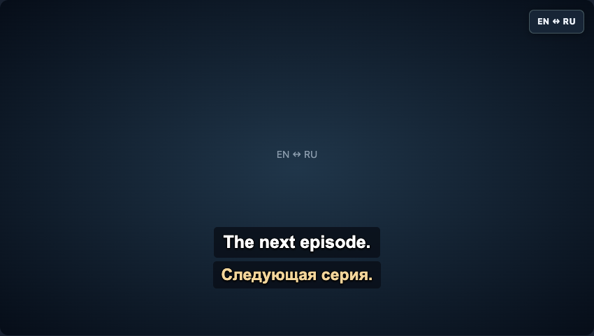

# Rezka · двойные субтитры

Локальное расширение Manifest V3 для Chrome и совместимых браузеров: английская реплика с русским переводом по нажатию либо два языка одновременно. Версия 0.1.0.

- [Скачать CRX3 для Яндекс Браузера](https://github.com/stormrvge/rezka-dual-subtitles/raw/refs/heads/main/dist/rezka-dual-subtitles.crx)
- [Скачать ZIP для Chrome / Edge](https://github.com/stormrvge/rezka-dual-subtitles/raw/refs/heads/main/dist/rezka-dual-subtitles.zip)




## Установка

1. Распакуй ZIP. Нужна папка `rezka-dual-subtitles`, внутри которой лежит `manifest.json`.
2. В Chrome открой `chrome://extensions`.
3. Включи «Режим разработчика» → «Загрузить распакованное расширение».
4. Выбери папку `rezka-dual-subtitles`.
5. Обнови страницу HDRezka и выбери «Оригинал (+субтитры)».

### Яндекс Браузер: готовый CRX3

1. Скачай готовый `rezka-dual-subtitles.crx` рядом с ZIP. Это подписанный пакет формата **CRX3**; стандартное расширение имени файла — `.crx`.
2. Открой в Яндекс Браузере `browser://tune`.
3. Перетащи файл `.crx` из Finder в окно Браузера и подтверди установку.
4. Расширение появится в разделе «Из других источников». Обнови HDRezka.

Инструкция Яндекса: https://browser.yandex.ru/help/ru/personalization/extension.html

Для CRX проверены версия формата 3, RSA-подпись и совпадение файлов с исходниками. Установка пакета в Яндекс Браузер отдельно не выполнялась.

В Edge управление расширениями находится на `edge://extensions`. Основной автоматический тест выполнен в Chromium; отдельная проверка Edge не выполнялась.

Официальная инструкция Chrome: https://developer.chrome.com/docs/extensions/get-started/tutorial/hello-world#load-unpacked

## Использование

- Над видео справа появится кнопка **EN ↔ RU**. Она открывает настройки.
- По умолчанию виден английский. Нажми на реплику: ниже появится русский перевод. Повторное нажатие скрывает его; при следующей английской реплике перевод снова скрывается.
- Режим **EN + RU постоянно** показывает обе дорожки.
- В самом плеере отключи обычные субтитры: **Субтитры → откл.**. PlayerJS рисует их собственным слоем, иначе они могут дублироваться с расширением.
- Английский и русский выбираются автоматически, если доступны. В настройках можно выбрать другие дорожки.
- Задержка настраивается для каждого языка отдельно. Положительное значение показывает реплику позже.
- **Alt+R** показывает/скрывает перевод, **Alt+S** меняет режим. Комбинации не работают при вводе в поля.
- Если нужной дорожки нет, загрузи свой **SRT/VTT** в настройках. Файл читается локально, не отправляется на сервер и сбрасывается при смене серии.

Автоматическое подключение включено для `rezka.ag`, `hdrezka.sb`, `hdrezka.ag`, `hdrezka.me` и их поддоменов. На другом зеркале нажми значок расширения в панели браузера → **Подключить к этой странице**. На таком зеркале повторное подключение потребуется после полной перезагрузки страницы.

Если загрузку блокирует CORS, открой значок расширения и нажми **Разрешить загрузку субтитров**. Запрашивается доступ к конкретному серверу обнаруженных дорожек, после чего загрузку выполняет расширение. На проверенной дорожке `static.voidboost.com` есть `Access-Control-Allow-Origin: *`, дополнительное разрешение не потребовалось.

## Как это работает

Расширение читает `subtitle` и `subtitle_lns` из начальной конфигурации `sof.tv.initCDNSeriesEvents` и из уже выполняемых сайтом запросов `/ajax/get_cdn_series/`. Отдельных запросов для получения видеопотоков оно не делает.

Плеер получает дорожки в формате `[Русский]URL,[English]URL`. Расширение загружает только файлы субтитров, разбирает таймкоды и выводит текст над HTML-видео по `video.currentTime`. Русские и английские строки сопоставляются по времени. Их номера и количество могут различаться; при раскрытии допускается небольшая разница таймингов.

После смены серии старые реплики очищаются, запоздавшие ответы игнорируются. Настройки режима, размера и задержки сохраняются локально. Текст дорожек и локальных файлов в постоянное хранилище не записывается.

Формат и API PlayerJS: https://playerjs.com/docs/en=subtitles и https://playerjs.com/docs/en=apicommands

## Границы проверки

На открытой пользователем странице `https://hdrezka.sb/series/thriller/1931-proslushka-2002-latest.html` проверены DOM плеера и конфигурация первой серии: русский, английский и украинский VTT; обычный `<video>` в основном документе; стандартные `textTracks` пусты. Русский и английский файлы успешно прочитаны: 934 и 848 реплик соответственно. Полные файлы серии в поставку не включены.

Установка Manifest V3 и взаимодействия проверяются отдельным браузерным тестом на локально подставленной странице с такой же структурой. Это не означает сквозную проверку установленного расширения во время воспроизведения реального сериала.

Выполненная проверка: **38/38 Node-тестов**, синтаксис всех скриптов, установка и сценарии интерфейса в **Chrome for Testing 151.0.7922.34**. Браузерный тест прошёл оба режима, раскрытие перевода, перемотку, небольшой сдвиг таймингов, локальный SRT, сброс при смене серии, отклонение запоздавшего ответа, замену видео, полный экран и восстановление стандартных textTracks после отключения.

- Расширение рассчитано на сериалы и стандартный плеер HDRezka. Инициализация фильмов отдельно не реализована.
- Обе дорожки должны быть доступны у выбранной серии или предоставлены пользователем. Автоматического машинного перевода нет.
- Поддерживаются SRT и VTT. ASS/SSA нужно предварительно преобразовать в SRT/VTT.
- Полный экран DOM поддерживается; системный Picture-in-Picture и плеер внутри стороннего iframe могут не показывать слой расширения.
- Изменения сайта могут потребовать обновления адаптера. Закрытые и платные источники расширение не открывает.

## Разрешения и данные

- `storage`: настройки на этом компьютере.
- `activeTab` и `scripting`: подключение к открытому пользователем зеркалу по нажатию.
- Статические content scripts: только перечисленные домены HDRezka.
- `optional_host_permissions`: возможность запросить конкретный сервер субтитров, если чтение из страницы не работает. Доступ ко всем сайтам автоматически не выдаётся.

Нет аналитики, удалённого исполняемого кода, API-ключей и сервиса перевода. Загрузки файлов субтитров выполняются без cookies; переходы на другие адреса при загрузке запрещены. Максимальный размер файла — 5 МиБ.

## Проверка исходников

Нужен Node.js 20+:

```sh
node --test tests/*.test.cjs
```

Браузерный тест требует установленного `playwright` и Chromium:

```sh
npm install --no-save playwright
npx playwright install chromium
node tests/browser-smoke.cjs
```

Тест запускает отдельный временный профиль с расширением, подставляет страницу и короткие собственные субтитры вместо сетевых ответов. Реальные видео не загружаются. Для готового расширения Node.js и Playwright не нужны.
